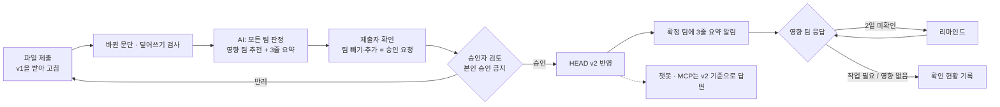
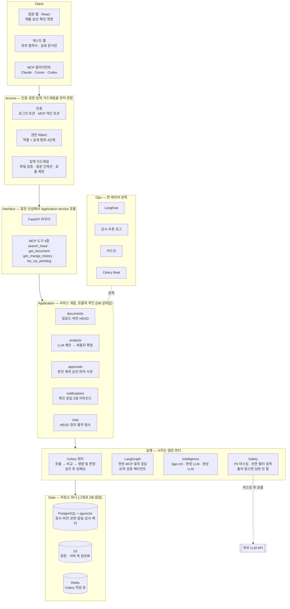
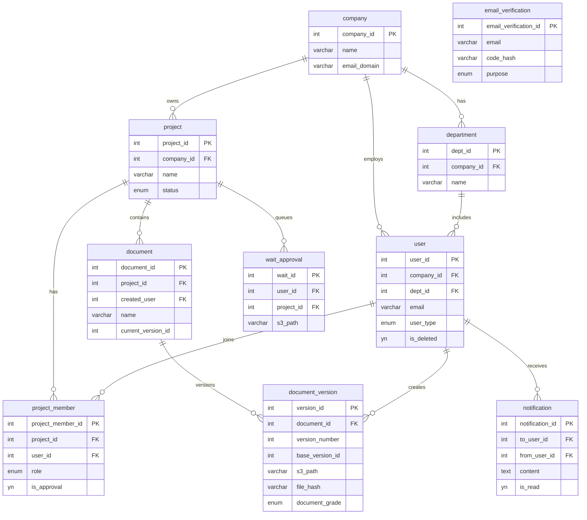

# 헤디 (Heady)

> **확정된 변경을, 영향받는 팀에만, 확인까지.**
> SKN35 최종 프로젝트 · 1팀 찐최종

변경 전파 누락을 해결해, **모든 팀이 같은 최신 문서(HEAD)로 일하게 하는** 팀 공용 문서 서비스입니다.

SI·에이전시 프로젝트에서 산출물이 바뀌면 **승인된 문서만 HEAD로 삼고**, AI가 추천한 영향 팀에 **검증된 3줄 요약으로 알린 뒤 팀별 확인 응답까지 추적**합니다.
HEAD 문서는 챗봇과 MCP 서버(Claude Code·Cursor·Codex)로 어디서든 출처와 함께 조회할 수 있습니다.

> 편집은 쓰던 Office·한글·Figma에서, 확정할 때 한 번만 헤디에.

---

## 해결하려는 문제

### 변경 전파 누락

> "이거 바뀐 거 아셨어요?" — 납품 사흘 전에 듣는 말

```
01 고객      무료배송 기준 5만 → 7만 원
02 기획      정의서 수정, 메신저로 몇 명에게만
03 개발·QA   여전히 5만 원 기준
04 납품 직전  불일치 발견 → 재작업
```

- 목표를 못 이룬 프로젝트의 **47%**가 요구사항 관리 부실을 주원인으로 꼽음 (PMI, _Pulse of the Profession: Requirements Management_, 2014)
- 늦게 발견할수록 비싸다: 납품 후 수정은 설계 단계보다 크게 비쌈, 작은 시스템도 약 5배 (Boehm & Basili, _IEEE Computer_, 2001)

### 원인 → 기능

목표는 **모든 팀이 같은 HEAD(승인된 최신본)를 보는 것**. 이를 막는 원인에서 기능을 파생했습니다.

| 원인                      | 기능                                                                                         |
| ------------------------- | -------------------------------------------------------------------------------------------- |
| 어느 게 최신본인지 모른다 | **HEAD**(승인된 버전만 기준) · **HEAD 덮어쓰기 검사**(3자 비교) · **챗봇·MCP**(HEAD만 근거)  |
| 누가 영향받는지 모른다    | **AI 영향 팀 추천**: 모든 팀을 판정해 제안 → 제출자가 빼거나 추가                            |
| 받았는지 모른다           | **검증된 3줄 요약** · **"작업 필요" / "영향 없음" 응답** · 미확인 빨간 점 · **2일 리마인드** |

### HEAD란?

**HEAD = 지금 모두가 따르는 승인된 최신본**

```
HEAD v1 (무료배송 5만 원) → 제출본 "v2 검토 중" (7만 원으로 수정) → 승인 → HEAD v2 (무료배송 7만 원)
```

1. 승인된 버전만 HEAD가 된다 · **본인 승인 금지**
2. 검토 중인 제출본은 챗봇·MCP가 보지 않는다
3. 고친 **기준 버전**이 현재 HEAD와 다르면 덮어쓰기 경고

### 무엇이 다른가

진짜 경쟁자는 지금 쓰는 메신저 공지입니다.

|                 | 메신저 공지                 | Confluence 구독       | **헤디**                        |
| --------------- | --------------------------- | --------------------- | ------------------------------- |
| 누구에게        | 보내는 사람이 기억나는 대로 | 구독자가 미리 골라 둠 | **바뀐 내용을 읽고 AI가 판정**  |
| 무엇이 바뀌었나 | 보내는 사람이 요약          | 파일을 직접 비교      | **검증된 3줄 요약 + 바뀐 문단** |
| 전달 이후       | 읽음 표시뿐                 | 알 수 없음            | **팀별 확인 응답 · 리마인드**   |
| 나중에 찾기     | 대화방 스크롤               | 검색 (초안 섞임)      | **HEAD만 근거로 답변**          |

Rovo·Glean 같은 AI 검색 도구는 사람이 물어봐야 답하는 **pull**형이고, 헤디는 변경이 확정되면 영향 팀을 찾아 먼저 알리는 **push**형입니다.

---

## 서비스 흐름



**AI는 제안까지만, 확정은 늘 사람이.** 흐름은 DB 상태값(분석 중 → 승인 대기 → 승인 → 반영 → 알림 완료)으로 관리되어, 서버가 재시작돼도 대기 상태가 그대로 남습니다.

### AI 설계 원칙: 놓치는 게 더 비싸다

QA팀을 빼먹으면 납품 직전 테스트 재작업, 팀을 하나 더 넣으면 '영향 없음' 클릭 한 번.

| 영역      | 결정                                                                                                             |
| --------- | ---------------------------------------------------------------------------------------------------------------- |
| 영향 팀   | 후보를 좁히지 않고 **모든 팀 판정** · AI 추천이 기본값, 제출자가 빼거나 추가                                     |
| 3줄 요약  | 요약 에이전트와 검증 에이전트 분리(누락·환각 검사), 재작성 최대 2회. **실패하면 지어내지 않고 바뀐 위치만** 표시 |
| 리마인드  | 확인할 때까지 2일마다 다시 알림                                                                                  |
| 알림 피로 | '영향 없음' 응답 비율을 함께 추적                                                                                |
| 권한      | 모델에 맡기지 않고 **DB 규칙으로만** 판정, 검색 단계부터 필터                                                    |
| 출처      | 챗봇 답변에 문서명·HEAD 버전·구간 필수. 출처를 댈 수 없으면 답하지 않음                                          |
| 기록      | 영향 판정 입력·출력·근거와 제출자 수정 내역을 추론 로그로 기록                                                   |

### 권한: 시스템 권한 × 프로젝트 역할 × 문서 공개 범위

| 구분               | 값                                                                                                      |
| ------------------ | ------------------------------------------------------------------------------------------------------- |
| 시스템 권한 (회사) | 어드민(시스템·유저 관리) · 매니저(프로젝트 생성) · 일반 사용자                                          |
| 프로젝트 역할      | 오너(PM: 설정·승인자 지정) · 팀장(PL: 팀원 초대·승인) · 멤버(제출·확인 응답) · 게스트(외부 공유만 열람) |
| 문서 공개 범위     | 사내 공개 · **프로젝트 내부(기본)** · 팀 내부 · 외부 공유                                               |

화면에서 숨기는 건 편의일 뿐, 모든 요청에서 서버가 권한을 다시 확인합니다. 게스트는 MCP를 쓸 수 없습니다.

---

## 아키텍처

**순서가 정해진 일은 워크플로우로, 판단이 필요한 일만 에이전트로.**
흐름은 백엔드(FastAPI)가 지휘하고, Celery 워커와 LangGraph는 실행만 합니다.



| 레이어                | 역할                                                            | 하지 않는 일               |
| --------------------- | --------------------------------------------------------------- | -------------------------- |
| FastAPI + DB 상태값   | 문서 상태 전이, 권한 판정                                       | 오래 걸리는 작업 직접 실행 |
| Celery                | 파싱·변경 분석·영향 판정·요약 등 긴 작업 실행                   | 다음 단계 결정             |
| LangGraph             | 질의 의도 분기, 권한 필터·출처 검증 강제, 요약·검증 재작성 루프 | 승인 흐름                  |
| PostgreSQL + pgvector | 정형 데이터·문서 참조 관계·임베딩을 한 트랜잭션으로             | 별도 그래프 DB             |
| S3                    | 원본 파일 보관                                                  | —                          |

### 기술 결정 (멘토링 후 덜어냄)

| 영역      | 결정                                      | 이유                                                                                       |
| --------- | ----------------------------------------- | ------------------------------------------------------------------------------------------ |
| 백엔드    | Django → **FastAPI**                      | 계산보다 LLM·파일·알림 대기가 많아 비동기                                                  |
| 저장소    | MySQL + Neo4j → **PostgreSQL + pgvector** | 권한 필터를 검색과 같은 쿼리에. 참조 거리는 참조 테이블 + 재귀 쿼리로 충분                 |
| 작업 큐   | **Celery** 후보                           | 12월 첫 주 부하 테스트로 확정                                                              |
| 판정 모델 | 미리 정하지 않음                          | 후보 4개(규칙 / 경량 ML / 경량 LLM / 플래그십 LLM) 비교, 정답지에서 놓친 팀이 가장 적은 것 |

---

## 기술 스택

| 영역        | 기술                                                                               |
| ----------- | ---------------------------------------------------------------------------------- |
| 백엔드      | Python 3.12, FastAPI, SQLAlchemy 2 (async) + asyncpg, Alembic, Pydantic, uv        |
| 인증        | JWT(PyJWT) + Argon2, 이메일 인증(aiosmtplib)                                       |
| 비동기 작업 | Celery + Redis, Celery Beat                                                        |
| 프론트엔드  | React 19, TypeScript 6.0, Vite, Tailwind CSS v4, React Router, TanStack Query, MSW |
| DB          | PostgreSQL 16 + pgvector (로컬은 Docker Compose)                                   |
| 저장소      | AWS S3 (버전 관리 + 수명 주기 규칙 + 서버 측 암호화)                               |
| 문서 추출   | Docling (+ HWPX 전용 파서)                                                         |
| 에이전트    | LangGraph                                                                          |
| 임베딩      | bge-m3 (자체 서버 실행) · OpenAI · EmbeddingGemma 3종 비교 후 1개 채택             |
| AI 판정     | 플래그십 LLM, 경량 LLM(GPT-6 Luna · Decisions API), scikit-learn 경량 ML           |
| AI 추적     | Langfuse (자체 호스팅)                                                             |
| MCP         | Python MCP SDK                                                                     |

---

## 데이터 모델 (ERD 초안)



> 11/23 기준 초안이며 보완 중입니다. `base_version_id`가 덮어쓰기 검사의 기준 버전, `document_grade`가 공개 범위 4단계입니다.

---

## 검증 계획

**검증 시나리오를 먼저 설계했습니다.** 문제를 만든 사람과 채점하는 사람을 나눕니다.

| 데이터         | 내용                                                                                                               |
| -------------- | ------------------------------------------------------------------------------------------------------------------ |
| 평가용 산출물  | 가상 SI 프로젝트(PMO + 6팀), 14종 문서, 버전 v1~v3                                                                 |
| 질문셋         | 챗봇·MCP 답변 평가용 질문 96개                                                                                     |
| 영향 판정 정답 | 변경 × 팀 쌍 라벨 (예: CHG-001 무료배송 5만 → 7만: 디자인·주문결제·공통기술·QA 영향 있음 / 회원상품·PMO 영향 없음) |
| 최종 테스트셋  | 사람이 직접 작성, 작성자가 아닌 2명이 독립 라벨링 (Cohen's kappa), 테스트 전 동결                                  |

| 지표                         | 최소 기준                                                          |
| ---------------------------- | ------------------------------------------------------------------ |
| **영향 판정 재현율 (1순위)** | 0.9 이상 · 가설: 사람 판정 대비 영향 팀 누락 절반 이하             |
| 챗봇 권한 위반율             | 0%                                                                 |
| 출처 표시율                  | 100%                                                               |
| 요약 누락률·환각률           | 1차 측정 후 확정 (일부러 틀린 요약을 넣어 검증 에이전트 성능 확인) |
| 영향 팀 제안 시간            | 제출 후 30초 이내                                                  |
| 알림 도착 시간               | 승인 후 1분 이내                                                   |

흐름 검증은 제출자·승인자·팀원 역할 봇이 시나리오를 반복해 끝까지 연결되는지 확인합니다.

---

## 개발 현황

> 2026-11-24 기준

| 상태       | 내용                                                                                                                   |
| ---------- | ---------------------------------------------------------------------------------------------------------------------- |
| ✅ 완료    | 기획서 · 기능명세 · 아키텍처 · ERD 초안 · 프론트 목업 6종 · 회사 가입·로그인·프로젝트 API · 평가용 문서 14종·질문 96개 |
| 🚧 진행 중 | 문서 API · 파서 연동 · 한글 파서 실험 · 정규화·문단 diff · ERD 보완 · React 화면 구현                                  |
| ⏳ 다음    | 영향 판정·요약 프롬프트 · 제출 → 승인 → 알림 연결 · 요약·검증·질의응답 에이전트 · MCP 서버 · AWS 배포                  |

### 일정

| 단계         | 기간                     | 목표                                                                               |
| ------------ | ------------------------ | ---------------------------------------------------------------------------------- |
| 1단계 MVP    | ~ 11/26 (중간발표)       | 핵심 시나리오 설계·목업 데모, 평가셋·권한 모델·실험 설계                           |
| 2단계 고도화 | 11/27 ~ 12/30 (최종발표) | 흐름 실제 연결 → 판정 모델 비교 → 사용자 테스트, MCP·감사 로그·PII 마스킹·리마인드 |

### 현재 구현된 API

모든 API는 `/api/v1` 아래에 있으며, 전체 목록은 백엔드 실행 후 Swagger(`/docs`)에서 확인합니다.

| 모듈            | 내용                                                                         |
| --------------- | ---------------------------------------------------------------------------- |
| `auth`          | 회사·개인 이메일 인증, 회원가입, 로그인, 토큰 재발급(refresh 쿠키), 로그아웃 |
| `organizations` | 회사 정보, 회사 사용자 목록, 부서 목록                                       |
| `projects`      | 프로젝트 생성·목록·상세, 멤버 조회                                           |
| `documents`     | 제출 파일 업로드·다운로드 (진행 중)                                          |

---

## 실행 방법

> 개발 초기 단계라 명령어는 바뀔 수 있습니다.

### 사전 준비

- Python 3.12, [uv](https://docs.astral.sh/uv/), Node.js 24 LTS
- Docker Desktop (로컬 PostgreSQL + pgvector 실행용)

### 1. 환경 변수

```bash
# macOS (zsh)
cp .env.example .env
```

```powershell
# Windows (PowerShell)
copy .env.example .env
```

`.env`에서 최소한 아래 값을 채웁니다. 백엔드는 `POSTGRES_*` 값으로 DB 주소를 직접 만듭니다.

| 변수                                                  | 설명                                                               |
| ----------------------------------------------------- | ------------------------------------------------------------------ |
| `POSTGRES_USER` / `POSTGRES_PASSWORD` / `POSTGRES_DB` | 로컬 DB 계정 (Docker Compose와 공용)                               |
| `POSTGRES_HOST` / `POSTGRES_PORT`                     | 기본 `localhost` / `5432`                                          |
| `JWT_SECRET_KEY`                                      | `openssl rand -hex 32`로 생성                                      |
| `MAIL_ENABLED`                                        | `false`면 인증번호를 메일 대신 서버 콘솔에 출력 (로컬 개발 기본값) |

### 2. DB (PostgreSQL + pgvector)

```bash
docker compose up -d        # 프로젝트 루트에서 실행, 첫 실행 시 pgvector 확장 자동 생성
```

### 3. 백엔드

```bash
cd backend
uv sync
uv run uvicorn app.main:app --reload
```

- API 문서(Swagger): http://localhost:8000/docs
- DB 마이그레이션(Alembic)은 설정 추가 예정입니다.

### 4. 프론트엔드

```bash
cd frontend
npm install
npm run dev                 # http://localhost:5173
```

백엔드 API가 준비되기 전에는 MSW 목업 응답으로 동작합니다. 자세한 내용은 [`frontend/README.md`](frontend/README.md)를 참고하세요.

---

## 폴더 구조

```
├─ backend/
│  └─ app/
│     ├─ main.py · api.py       # FastAPI 앱, /api/v1 라우터 묶음
│     ├─ core/                  # 설정, 보안(JWT·비밀번호), 공통 예외·enum
│     ├─ db/                    # Base, 세션, 전체 모델 import
│     ├─ auth/                  # 인증 · 이메일 인증 · 메일 발송
│     ├─ organizations/         # 회사 · 부서 · 사용자
│     ├─ projects/              # 프로젝트 · 멤버
│     ├─ documents/             # 문서 제출 (업로드·다운로드)
│     └─ pipeline/              # 순수 함수: parsing · normalizing · chunking · entities · diff
├─ frontend/                    # Vite + React + TS (src/: api · mocks · pages · components · hooks)
├─ data/docset/                 # 가상 프로젝트 합성 데이터셋 (DATA-01), build_docset.py로 생성
├─ docker/postgres/init/        # DB 초기화 SQL (pgvector 확장)
└─ docker-compose.yml           # 로컬 PostgreSQL
```

기능 모듈은 `router.py`(HTTP) / `service.py`(유스케이스·트랜잭션) / `repository.py`(DB 접근) / `models.py` / `schemas.py`로 나눕니다.
`pipeline/`은 FastAPI·SQLAlchemy에 의존하지 않는 순수 Python으로 유지합니다. 자세한 규칙은 [`CLAUDE.md`](CLAUDE.md)를 참고하세요.

---

## 팀원과 역할 (Team 찐최종)

| 이름   | 주 담당                          | 보조                |
| ------ | -------------------------------- | ------------------- |
| 박수휘 | 문서 처리 파이프라인, 프론트엔드 | AI(LLM·에이전트)    |
| 정은미 | AI(LLM·에이전트·RAG)             | 문서 처리           |
| 박찬룡 | 백엔드, MCP 서버                 | 프론트엔드          |
| 최우석 | 배포·인프라                      | 백엔드, 판정·검증   |
| 차윤정 | 영향 판정·평가                   | MCP 서버, 문서 처리 |

> 11/17 파트 분담 기준. LLM·에이전트 작업은 팀원 전원이 함께합니다.

### 협업 규칙

- 브랜치: 개인 이름 브랜치 → `dev` → `main` (`main`·`dev` 직접 push 금지, PR로 병합)
- 커밋: `feat` / `fix` / `docs` / `add` + `: 내용` (예: `feat: DOCX 문단 분할 추가 (CHG-01)`)
- 이슈는 `.github/ISSUE_TEMPLATE` 사용, PR 본문에 이슈 번호와 기능 ID 기재

---

## 상세 문서

| 문서                                             | 내용                                                                        |
| ------------------------------------------------ | --------------------------------------------------------------------------- |
| [`CLAUDE.md`](CLAUDE.md)                         | 프로젝트 요약, 아키텍처 원칙, 의존 방향, 브랜치·커밋 규칙, OS 혼용 주의사항 |
| [`frontend/README.md`](frontend/README.md)       | 프론트엔드 기술 스택, 실행·코드 품질 명령                                   |
| [`data/docset/README.md`](data/docset/README.md) | 합성 데이터셋 구성, 학습·평가 분리 원칙, 생성 방법                          |
| API 문서                                         | 백엔드 실행 후 http://localhost:8000/docs (Swagger)                         |

<!-- 추가 예정: 기획서, 기능명세서, 아키텍처 그림(v3), ERD 이미지 (docs/) -->

---

> "최신 기획서? 헤디한테 물어봐."
