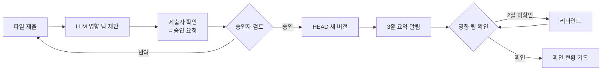
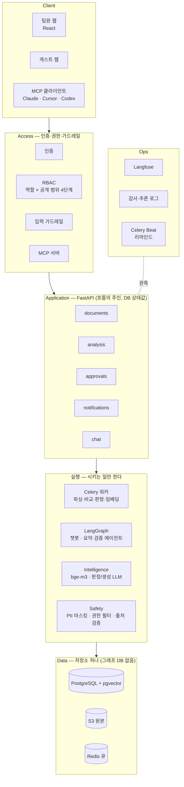

# 회사 공용 브레인 (가칭)

> **확정된 변경을 영향받는 팀에만 알리고, 확인까지 추적한다.**
> SKN35 최종 프로젝트 · 1팀

SI·에이전시 프로젝트에서 기획 산출물이 바뀌면, **승인된 문서만 기준(HEAD)으로 삼고**, LLM이 제안한 영향 팀에 **3줄 요약으로 알린 뒤 팀별 확인 여부를 추적**하는 서비스입니다.
기준 문서는 챗봇과 MCP 서버(Claude Code·Cursor·Codex)로 어디서든 출처와 함께 조회할 수 있습니다.

---

## 해결하려는 문제

### 변경 전파 누락
> 기획 산출물이 바뀌어도 영향받는 디자인·개발 팀이 제때 알지 못해, 개발이 끝난 뒤에야 불일치가 발견되고 재작업이 생깁니다.

현장에서 변경은 보통 "고객 요청 → 메신저·회의로 전달 → 개발 반영 → 납품 직전 산출물 갱신" 순서로 흐릅니다. 그래서 문서는 실제 변경보다 늦게 고쳐지고, 누가 그 변경을 알고 있는지 아무도 모릅니다.

| 변경이 전파되지 않는 원인 | 해결 기능 |
|---|---|
| 무엇이 확정된 변경인지 기준이 없다 | **HEAD**: 승인된 문서만 기준이 됨 |
| 누가 영향받는지 모른다 | **영향 팀 선별**: LLM이 모든 팀을 판정해 제안 → 제출자가 확정 |
| 무엇이 바뀌었는지 파악이 오래 걸린다 | **3줄 요약 + 변경 보기** (요약·검증 에이전트) |
| 받았는지, 반영할 건지 모른다 | **확인 응답**("작업 필요"/"영향 없음") + 미확인 빨간 점 + 2일 리마인드 |
| 나중에 기준을 다시 찾기 어렵다 | **챗봇·MCP**: HEAD만 근거로 출처를 붙여 답변 |
| 확정된 변경이 다른 수정에 덮여 사라진다 | **HEAD 덮어쓰기 검사** (3자 비교) |

### 서비스 흐름



---

## 아키텍처

**원칙: 흐름은 백엔드(FastAPI)가 지휘하고, Celery 워커와 LangGraph는 실행만 한다.**



<!-- 상세 그림: [`docs/architecture.png`](docs/architecture.png) -->

| 레이어 | 역할 | 하지 않는 일 |
|---|---|---|
| FastAPI + DB 상태값 | 문서 상태 전이(분석 중 → 승인 대기 → 승인 → 반영 → 알림 완료), 권한 판정 | 오래 걸리는 작업 직접 실행 |
| Celery | 파싱·변경 분석·영향 판정·요약 등 긴 작업 실행 | 다음 단계 결정 |
| LangGraph | 챗봇 의도 분기, 권한 필터·출처 검증 강제, 요약·검증 재작성 루프 | 승인 흐름 |
| PostgreSQL + pgvector | 정형 데이터·문서 참조 관계·임베딩을 한 트랜잭션으로 | 별도 그래프 DB 없음 |

---

## 기술 스택

| 영역 | 기술 |
|---|---|
| 백엔드 | Python 3.12, FastAPI, Pydantic, uv |
| 비동기 작업 | Celery + Redis, Celery Beat |
| 프론트엔드 | React, TypeScript, Vite, Tailwind CSS |
| DB | PostgreSQL + pgvector |
| 저장소 | AWS S3 |
| 문서 추출 | Docling |
| 에이전트 | LangGraph |
| 임베딩 | bge-m3 (자체 서버 실행) |
| AI 판정 | 플래그십 LLM, 경량 LLM(GPT-6 Luna · Decisions API), scikit-learn 경량 ML |
| AI 추적 | Langfuse (자체 호스팅) |
| MCP | Python MCP SDK |

---

## 실행 방법

> 개발 초기 단계라 명령어는 바뀔 수 있습니다.

### 사전 준비
- Python 3.12, [uv](https://docs.astral.sh/uv/), Node.js 24 LTS
- 개발 DB: 각자 [Supabase](https://supabase.com) 무료 프로젝트 생성 (PostgreSQL + pgvector)

### 백엔드

```bash
cd backend
cp ../.env.example ../.env        # Windows: copy ..\.env.example ..\.env  → 값 채우기
uv sync                           # 의존성 설치 (문서 파싱 포함: uv sync --group parsing)
uv run alembic upgrade head       # DB 테이블 생성
uv run uvicorn app.main:app --reload
```

- API 문서(Swagger): http://localhost:8000/docs
- 로컬 개발 중에는 `.env`의 `CELERY_TASK_ALWAYS_EAGER=true`로 Redis·워커 없이 실행
- 워커를 따로 띄울 때: `uv run celery -A app.worker.celery_app worker` (Windows는 `--pool=solo` 추가)

### 프론트엔드

```bash
cd frontend
npm install
npm run dev                       # http://localhost:5173
```

백엔드 API가 준비되기 전에는 MSW 목업 응답으로 동작합니다.

---

## 폴더 구조

<!-- ```
├─ backend/app/
│  ├─ core/  common/  modules/       # 설정 · 공통(인증·권한·감사) · 기능 모듈
│  ├─ pipeline/                      # 문서 파싱·엔티티·diff (순수 함수)
│  ├─ intelligence/  safety/         # 판정·임베딩·요약 · PII·가드레일·출처 검증
│  ├─ integrations/  worker/         # S3·LLM·Langfuse · Celery
│  └─ mcp_server/
├─ frontend/src/                     # api · mocks · pages · components · hooks
├─ evaluation/                       # 평가셋 · 라벨링 · 실험
└─ docs/
```

자세한 구조와 규칙: [`docs/폴더구조_최종.md`](docs/폴더구조_최종.md) -->

---

## 팀원과 역할

| 이름 | 주 담당 | 보조 |
|---|---|---|
| OO | 문서 처리 파이프라인, 프론트엔드 | AI(LLM·에이전트) |
| OO | AI(LLM·에이전트·RAG) | 문서 처리 |
| OO | 백엔드, MCP 서버 | 프론트엔드 |
| OO | 배포·인프라 | 백엔드, 판정·검증 |
| OO | 영향 판정·평가 | MCP 서버, 문서 처리 |

> 11/17 파트 분담 기준. LLM·에이전트 작업은 팀원 전원이 함께합니다.

### 협업 규칙
- 브랜치: 개인 이름 브랜치 → `dev` → `main`
- 커밋: `feat` / `fix` / `docs` / `add` + `: 내용` (예: `feat: DOCX 문단 분할 추가 (CHG-01)`)

---

## 상세 문서

| 문서 | 내용 |
|---|---|
<!-- | [기획서](docs/기획서_최종본.md) | 문제 정의, 기능, 아키텍처, 평가 계획, 리스크 |
| [기능명세서](docs/기능명세서.xlsx) | 기능 ID별 상세·우선순위·단계, 평가·실험 항목 |
| [아키텍처](docs/architecture.png) | 레이어·기능 컴포넌트·프로세스 흐름 |
| [폴더 구조](docs/폴더구조_최종.md) | 폴더 구조, 모듈 규칙, import 규칙 |
| [ERD](docs/erd/) | DB 설계 (작성 예정) |
| API 문서 | 백엔드 실행 후 `/docs` (Swagger) | -->